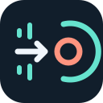

<p align="center">
  
</p>

# Cast2Sendspin

**YouTube Music → Music Assistant → your speakers.**

Cast from the official YouTube Music app using the casting person's account,
including Premium-quality audio. No shared Google login or browser cookies.

- Expose individual Music Assistant speakers as named receivers.
- Or use one receiver and choose the player or group in Music Assistant.
- Control playback, seeking, and volume from YouTube Music.
- Keep YouTube's queue and autoplay, without replacing your MA queue.
- Manage receivers in a small local web UI.

## Quickstart

Run locally to get started or try it out—**Docker is optional**. Once dependencies
and configuration are set up, **`npm start` is all you need to launch the app**.

You'll need Node.js 22+, Python 3.14+, and FFmpeg, on the same LAN as your phone,
with Music Assistant and its Sendspin Source provider available.

1. Clone this repository, then prepare your configuration:

   ```sh
   cp config.example.json config.json
   mkdir -p .state
   chmod 700 .state
   touch .ma_token
   chmod 600 .ma_token
   ```

2. Edit these files:
   - **`config.json`**: set your MA URL, Sendspin URL, and host LAN interface
     (`ip -brief address` lists interfaces).
   - **`.ma_token`**: paste an MA access token with player-control and
     provider/player-configuration permissions.

3. Install dependencies once, then start:

   ```sh
    npm ci --ignore-scripts
    python3 -m venv .venv
    .venv/bin/pip install -r requirements.txt
    npm start
   ```

4. Open **http://localhost:8790**, name a receiver, and enable it.

5. Open YouTube Music, tap **Cast**, select your receiver, and play.

For manual routing, select **Single source** in the UI, then play its input from
**Browse → Sendspin Source** on your chosen MA player or group.

## Docker (optional)

For a Linux homelab server, **[`compose.yaml`](compose.yaml)** pulls a prebuilt
GHCR image instead. Use the same `config.json` and `.ma_token` from above; no
local Node.js, Python, or FFmpeg installation is needed.

Copy **[`.env.example`](.env.example)** to `.env`, set
`IMAGE=ghcr.io/YOUR_GITHUB_USER/cast2sendspin:latest` using your lowercase GitHub
name, and match `PUID`/`PGID` to the files' owner. Stop any locally running
instance before starting Docker.

```sh
cp .env.example .env
# Edit .env, then:
docker compose up -d
```

### Updates

```sh
docker compose pull
docker compose up -d
```

Keep `.state/`, `config.json`, and `.ma_token` when upgrading.
The management UI stays loopback-only; keep receiver ports on your trusted LAN.

## Build & publish

Push this repository to GitHub. The included Actions workflow tests the app and
publishes **amd64 + arm64** images to `ghcr.io/<owner>/<repo>` on `main` and
`v*` tags. Set the GHCR package visibility to **Public** to pull without login.
Use that image path in `.env` if you choose a different repository name.

To build locally:

```sh
docker build -t cast2sendspin:local .
IMAGE=cast2sendspin:local docker compose up -d
```

## Development

After the local setup above, run the tests with:

```sh
npm test
PYTHONPATH=src .venv/bin/python -m unittest discover -s tests
```

### Repository layout

```text
src/            Backend code (Node.js and Python)
src/web/        Management UI and icon
tests/          Node.js and Python tests
.github/        CI and multi-architecture GHCR publishing
compose.yaml    Homelab deployment using a GHCR image
Dockerfile      Local and CI container builds
```

Anonymous yt-dlp fallback is off by default. Enable it explicitly with
`"allow_anonymous_fallback": true` in `config.json`.

[Apache 2.0](LICENSE) · [Third-party notices](THIRD_PARTY_NOTICES.md)

Not affiliated with Google, YouTube, or Music Assistant.
